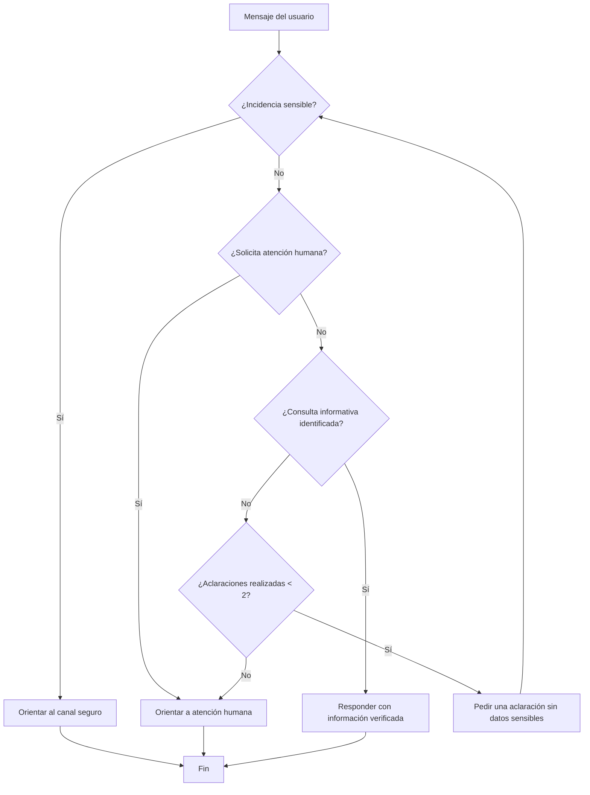

# Flujo conversacional — Tarjetas

Este diagrama es una **representación conceptual**, no un proceso ejecutable. Debe interpretarse junto a `../requisitos/reglas-negocio.md`.

## Significado de las rutas

- **Canal seguro:** orientación al uso de canales oficiales verificados; nunca implica bloqueo ni acceso a datos reales.
- **Atención humana:** salida para solicitudes expresas o dos aclaraciones sin resolución.
- **Informativa:** respuesta general cuando existe información suficiente y verificada.
- **Aclaración:** pregunta para determinar la intención. Su contador se mantiene durante la misma consulta.

## Revisión recomendada

Al analizar el flujo, contrastar cada bifurcación con `REQ-FRA-03`, `REQ-HUM-05`, `REQ-ENR-02` y `REQ-SEC-07`. El objetivo docente es encontrar relaciones entre requisitos, prompt y diagrama.
